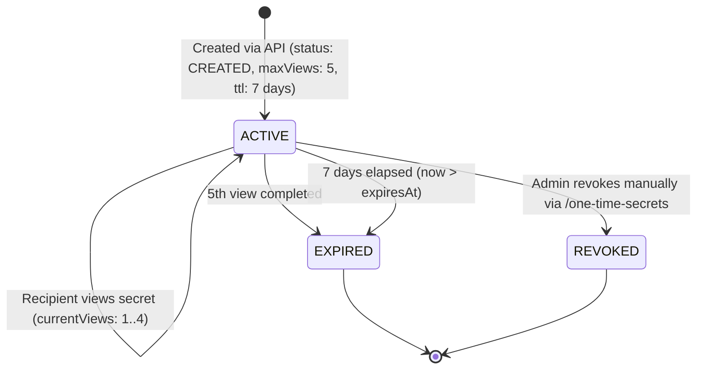

# CredSecure – External API Guideline: One-Time Secret Creation

## 1. Overview & Purpose

The **One-Time Secrets (OTS) API** (`POST /api/v1/one-time-secrets`) enables authorized external systems (HR portals, ITSM platforms, Identity & Access Management systems, CI/CD pipelines, and internal microservices) to programmatically generate secure, ephemeral credentials and one-time secret access links.

### Key Capabilities
- **Automated Password Generation**: Cryptographically generates an enterprise-safe, 16-character password with enforced complexity (`A-Z`, `a-z`, `0-9`, special characters).
- **Decoupled Cryptographic Storage**: Secrets are symmetrically encrypted at rest using AES-256-GCM.
- **Dual Deliverable Response**: Returns both the raw `generatedPassword` (returned strictly once) and the secure retrieval link (`otsLink`).
- **Zero Email Dispatch**: The External API triggers no automatic email notifications. Consuming systems have complete freedom over how the access link is presented or delivered to the recipient.
- **Strict Lifecycle Bounds**: Enforces a 7-day expiration window and a maximum of 5 successful views.
- **Collision-Proof Deduplication**: Supports an optional external `referenceId` unique to the calling API client, preventing duplicate secret generation for the same business event.

---

## 2. Authentication & Authorization

All requests to the OTS API require OAuth 2.0 authentication. The endpoint integrates directly with CredSecure's existing External API security architecture.

### Step 1: Obtain an Access Token
Before calling the OTS API, exchange your client credentials for a short-lived Bearer JWT via the token endpoint:

- **Endpoint**: `POST /api/v1/auth/token`
- **Content-Type**: `application/x-www-form-urlencoded` or `application/json`
- **Authentication**: HTTP Basic Auth (`Authorization: Basic base64(client_id:client_secret)`) or form body.

#### Token Request Example (cURL)
```bash
curl -X POST "https://<your-credsecure-domain>/api/v1/auth/token" \
  -H "Authorization: Basic $(echo -n 'YOUR_CLIENT_ID:YOUR_CLIENT_SECRET' | base64)" \
  -H "Content-Type: application/x-www-form-urlencoded" \
  -d "grant_type=client_credentials"
```

#### Token Response (HTTP 200 OK)
```json
{
  "access_token": "eyJhbGciOiJIUzI1NiIsInR5cCI6IkpXVCJ9...",
  "token_type": "Bearer",
  "expires_in": 300
}
```

---

### Step 2: Client Security Modes
Depending on the **Security Mode** configured on your API Client in CredSecure Admin, additional security headers may be required:

| Security Mode | Required Headers | Description |
|---|---|---|
| **BASIC** | `Authorization: Bearer <token>` | Standard OAuth 2.0 Bearer JWT authentication. |
| **SECURE** | `Authorization: Bearer <token>`<br>`x-client-verify: SUCCESS` | OAuth 2.0 + Mutual TLS (mTLS) client certificate verification. |
| **ENTERPRISE** | `Authorization: Bearer <token>`<br>`x-client-verify: SUCCESS`<br>`x-api-signature: <hex_hmac>`<br>`x-api-timestamp: <epoch_ms>` | OAuth 2.0 + mTLS + HMAC-SHA256 request signature validation. |

#### Computing the Enterprise HMAC Signature
In **ENTERPRISE** mode, the client must compute an HMAC-SHA256 signature using their `client_secret`:
- **Data to sign**: `${request_path}:${timestamp}` (e.g. `/api/v1/one-time-secrets:1730894400000`)
- **Algorithm**: HMAC-SHA256
- **Encoding**: Hexadecimal
- **Timestamp tolerance**: Requests with timestamps older than 5 minutes (300,000 ms) are rejected.

---

## 3. API Reference: `POST /api/v1/one-time-secrets`

### 3.1 Endpoint Information
| Attribute | Value |
|---|---|
| **HTTP Method** | `POST` |
| **Endpoint URL** | `/api/v1/one-time-secrets` |
| **Content-Type** | `application/json` |
| **Response Headers** | `Cache-Control: no-store, no-cache, must-revalidate, proxy-revalidate`<br>`Pragma: no-cache`<br>`Expires: 0` |

---

### 3.2 Request Headers
| Header | Type | Mandatory | Description |
|---|---|---|---|
| `Authorization` | string | **Yes** | Bearer JWT (`Bearer <access_token>`). |
| `Content-Type` | string | **Yes** | Must be `application/json`. |
| `x-client-verify` | string | Conditional | Must be `SUCCESS` if API client is in `SECURE` or `ENTERPRISE` mode. |
| `x-api-signature` | string | Conditional | Hex HMAC-SHA256 signature if API client is in `ENTERPRISE` mode. |
| `x-api-timestamp` | string | Conditional | Epoch timestamp in milliseconds if API client is in `ENTERPRISE` mode. |

---

### 3.3 Request Body Schema

```json
{
  "userName": "John Smith",
  "email": "john.smith@example.com",
  "referenceId": "ONBOARD-2026-001"
}
```

#### Field Specifications
| Field | Type | Mandatory | Constraints | Description |
|---|---|---|---|---|
| `userName` | string | **Yes** | 1 to 100 characters after trimming | The recipient's full name. Stored for administrative visibility and audit tracking. |
| `email` | string | **Yes** | Valid RFC 5322 email format | The recipient's email address. Normalized to lowercase. |
| `referenceId` | string | **No** | 1 to 100 characters after trimming | External business tracking identifier (e.g., employee ID, ticket number). Enforces idempotency for the calling client. |

---

### 3.4 Response Contracts

#### 1. Success Response — HTTP 201 Created
Returned when the secret is successfully generated and encrypted.

```json
{
  "success": true,
  "otsId": "3b2f5a89-2e1c-4b5a-9f8e-7d6c5b4a3a21",
  "referenceId": "ONBOARD-2026-001",
  "userName": "John Smith",
  "email": "john.smith@example.com",
  "generatedPassword": "K9@mP4#xT7$qL2z!",
  "otsLink": "https://vault.company.local/share/2e8e53c58999a49ee3ab17a7864127eaa1cf9d492ce9604c79e9027dbf186096",
  "status": "CREATED",
  "expiresAt": "2026-11-13T12:00:00.000Z",
  "maxViews": 5
}
```

##### Field Descriptions
- **`success`** *(boolean)*: `true` indicating successful creation.
- **`otsId`** *(string)*: Unique UUID identifier of the One-Time Secret record in CredSecure.
- **`referenceId`** *(string | null)*: The external tracking identifier submitted in the request.
- **`userName`** *(string)*: Recipient name.
- **`email`** *(string)*: Recipient email address.
- **`generatedPassword`** *(string)*: The 16-character generated password. **Only returned in this initial response.**
- **`otsLink`** *(string)*: Full URL for accessing and viewing the secret via browser.
- **`status`** *(string)*: Initial state, always `"CREATED"`.
- **`expiresAt`** *(string)*: ISO 8601 timestamp exactly 7 days (168 hours) from creation.
- **`maxViews`** *(number)*: Maximum allowed views, fixed at `5`.

> [!IMPORTANT]
> **One-Time Password Visibility**: The `generatedPassword` is returned in plaintext **only once** in this HTTP 201 response. CredSecure never stores the password in plaintext and cannot re-reveal it via API.

---

#### 2. Duplicate Reference Response — HTTP 409 Conflict
Returned when a request includes a `referenceId` that already exists for the **same API client**.

```json
{
  "success": false,
  "error": "Conflict",
  "message": "A secret with referenceId 'ONBOARD-2026-001' already exists for this client.",
  "otsId": "3b2f5a89-2e1c-4b5a-9f8e-7d6c5b4a3a21",
  "referenceId": "ONBOARD-2026-001"
}
```

##### Key Deduplication Rules
- **Idempotency Guarantee**: If your workflow encounters a network retry or submits the same reference ID, CredSecure will **not** generate another password or create a duplicate secret.
- **Privacy Preservation**: The 409 Conflict response returns the existing `otsId` and `referenceId`, but **never** exposes the previously generated password or OTS link.
- **Cross-Client Scoping**: Reference IDs are scoped per API Client. Client A and Client B can safely use identical reference IDs without conflict.

---

#### 3. Error Responses

##### HTTP 400 Bad Request
Returned when request validation fails (missing `userName`, malformed `email`, or malformed JSON).

```json
{
  "success": false,
  "error": "Bad Request",
  "message": "Validation failed",
  "details": {
    "userName": ["userName cannot be empty"],
    "email": ["Invalid email address format"]
  }
}
```

##### HTTP 401 Unauthorized
Returned when authentication credentials are missing, expired, or invalid.

```json
{
  "error": "Missing or invalid Bearer token"
}
```
*(Also returned if client is disabled, mTLS header is missing, or Enterprise HMAC signature fails validation).*

##### HTTP 403 Forbidden
Returned if the client's IP address has been temporarily or permanently blocked due to repeated security violations.

```json
{
  "error": "Forbidden. IP is blocked due to abuse."
}
```

##### HTTP 404 Not Found
Returned when External API access is globally disabled in CredSecure System Settings (`allowApiAccess: false`).

##### HTTP 429 Too Many Requests
Returned when the API Client or source IP exceeds the configured rate limit.

```json
{
  "error": "Too Many Requests",
  "message": "Rate limit exceeded. Please try again later.",
  "retryAfter": 45
}
```
*Response includes standard headers: `Retry-After: 45`, `X-RateLimit-Limit`, `X-RateLimit-Remaining`, `X-RateLimit-Reset`.*

##### HTTP 500 Internal Server Error
Returned on unexpected system or database failures.

---

## 4. Lifecycle & Secret Consumption



### Viewing Rules
1. **Public Retrieval Flow**: When the recipient opens the `otsLink` (`https://<domain>/share/<token>`), CredSecure presents a secure verification page.
2. **Atomic Counter**: When the user clicks **Reveal Secret**, CredSecure atomically increments `currentViews`.
3. **Automatic Expiry**:
   - As soon as `currentViews >= 5`, status immediately transitions to `EXPIRED`.
   - If 7 days elapse from creation, the link automatically expires regardless of view count.
4. **Post-Expiry Behavior**: Once expired, any subsequent attempt to view the secret yields an `Access Denied` error.

---

## 5. Security & Compliance Safeguards

| Control Area | Implementation Guarantee |
|---|---|
| **Zero Plaintext Logging** | `generatedPassword`, the 64-character unhashed token, and `otsLink` are strictly excluded from all `AuditLog`, `ApiActivityLog`, application console output, and database query logs. |
| **Encryption at Rest** | Secrets are stored as AES-256-GCM ciphertext blocks containing a unique IV, authentication tag, and encrypted payload (`iv:authTag:ciphertext`). |
| **Cache Elimination** | All HTTP responses enforce `Cache-Control: no-store, no-cache, must-revalidate` to prevent intermediary proxies, CDNs, or browser caches from storing secret data. |
| **Database-Level Isolation** | Composite unique index `(api_client_id, reference_id)` is enforced at the MySQL storage engine level, preventing race conditions during concurrent API submissions. |
| **Audit Traceability** | Every creation request writes an immutable `ApiActivityLog` entry (capturing Client ID, IP, User-Agent, HTTP Status, Request ID) and a governance `AuditLog` entry (recording recipient name, email, OTS ID, and timestamp). |

---

## 6. Integration Examples

### 6.1 cURL (End-to-End)

```bash
#!/bin/bash
set -e

DOMAIN="https://vault.company.local"
CLIENT_ID="your-client-id"
CLIENT_SECRET="your-client-secret"

# 1. Fetch Bearer Token
TOKEN_RESPONSE=$(curl -s -X POST "$DOMAIN/api/v1/auth/token" \
  -H "Authorization: Basic $(echo -n "$CLIENT_ID:$CLIENT_SECRET" | base64)" \
  -H "Content-Type: application/x-www-form-urlencoded" \
  -d "grant_type=client_credentials")

ACCESS_TOKEN=$(echo $TOKEN_RESPONSE | jq -r '.access_token')

# 2. Create One-Time Secret
RESPONSE=$(curl -s -i -X POST "$DOMAIN/api/v1/one-time-secrets" \
  -H "Authorization: Bearer $ACCESS_TOKEN" \
  -H "Content-Type: application/json" \
  -d '{
    "userName": "Jane Doe",
    "email": "jane.doe@company.com",
    "referenceId": "ONBOARD-HR-9821"
  }')

echo "$RESPONSE"
```

---

### 6.2 Node.js / TypeScript (Fetch API)

```typescript
interface CreateOtsResponse {
  success: boolean;
  otsId: string;
  referenceId: string | null;
  userName: string;
  email: string;
  generatedPassword?: string;
  otsLink?: string;
  status?: string;
  expiresAt?: string;
  maxViews?: number;
  error?: string;
  message?: string;
}

async function createOneTimeSecret(
  baseUrl: string,
  accessToken: string,
  userName: string,
  email: string,
  referenceId?: string
): Promise<CreateOtsResponse> {
  const response = await fetch(`${baseUrl}/api/v1/one-time-secrets`, {
    method: 'POST',
    headers: {
      'Authorization': `Bearer ${accessToken}`,
      'Content-Type': 'application/json'
    },
    body: JSON.stringify({ userName, email, referenceId })
  });

  const data = await response.json();

  if (response.status === 201) {
    console.log(`✅ OTS Created successfully: ${data.otsId}`);
    console.log(`🔑 Generated Password: ${data.generatedPassword}`);
    console.log(`🔗 Shareable Link: ${data.otsLink}`);
    return data;
  } else if (response.status === 409) {
    console.warn(`⚠️ Duplicate Reference: Secret already exists (${data.otsId})`);
    return data;
  } else {
    throw new Error(`API Error [${response.status}]: ${data.message || data.error}`);
  }
}
```

---

### 6.3 Python 3 (Requests)

```python
import requests

def create_one_time_secret(base_url: str, access_token: str, user_name: str, email: str, reference_id: str = None):
    url = f"{base_url}/api/v1/one-time-secrets"
    headers = {
        "Authorization": f"Bearer {access_token}",
        "Content-Type": "application/json"
    }
    payload = {
        "userName": user_name,
        "email": email
    }
    if reference_id:
        payload["referenceId"] = reference_id

    response = requests.post(url, json=payload, headers=headers)

    if response.status_code == 201:
        data = response.json()
        print(f"Created OTS ID: {data['otsId']}")
        print(f"Generated Password: {data['generatedPassword']}")
        print(f"Access Link: {data['otsLink']}")
        return data
    elif response.status_code == 409:
        print(f"Conflict: Reference already exists ({response.json()['otsId']})")
        return response.json()
    else:
        response.raise_for_status()
```

---

### 6.4 PowerShell (Windows / Automation)

```powershell
$baseUrl = "https://vault.company.local"
$accessToken = "YOUR_BEARER_TOKEN"

$headers = @{
    "Authorization" = "Bearer $accessToken"
    "Content-Type"  = "application/json"
}

$body = @{
    userName    = "Jane Doe"
    email       = "jane.doe@company.com"
    referenceId = "TICKET-44021"
} | ConvertTo-Json

try {
    $response = Invoke-RestMethod -Uri "$baseUrl/api/v1/one-time-secrets" -Method Post -Headers $headers -Body $body
    Write-Host "OTS ID: $($response.otsId)" -ForegroundColor Green
    Write-Host "Password: $($response.generatedPassword)" -ForegroundColor Cyan
    Write-Host "Link: $($response.otsLink)" -ForegroundColor Yellow
} catch {
    $statusCode = $_.Exception.Response.StatusCode.value__
    $errorBody = $_.ErrorDetails.Message | ConvertFrom-Json
    Write-Host "Error [$statusCode]: $($errorBody.message)" -ForegroundColor Red
}
```

---

## 7. Frequently Asked Questions (FAQ)

#### Q1: Can I retrieve the password again via API if the caller loses it?
**No.** To comply with CredSecure's zero-knowledge security standard, the plaintext password is only returned in the initial HTTP 201 creation payload. If lost, the secret must be revoked or expired, and a new secret created.

#### Q2: Does the API send an email to the recipient?
**No.** The External API creates the secret and returns the `otsLink`. Consuming systems are responsible for embedding the link in their own onboarding communications, ticket replies, or custom notification channels.

#### Q3: Can an external application revoke or delete an OTS via this API?
**No.** The External API supports `POST` creation only. Revocation and administrative cleanup are managed directly by authorized administrators within the CredSecure Web UI (`/one-time-secrets`).

#### Q4: What happens if two identical requests arrive simultaneously?
CredSecure enforces a composite database unique index `(api_client_id, reference_id)`. The first request commits with HTTP 201, while the concurrent duplicate request is intercepted at the database level and returned with HTTP 409 Conflict.

